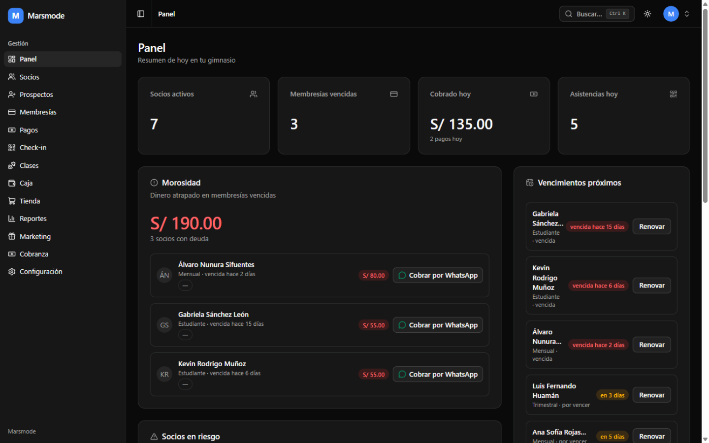
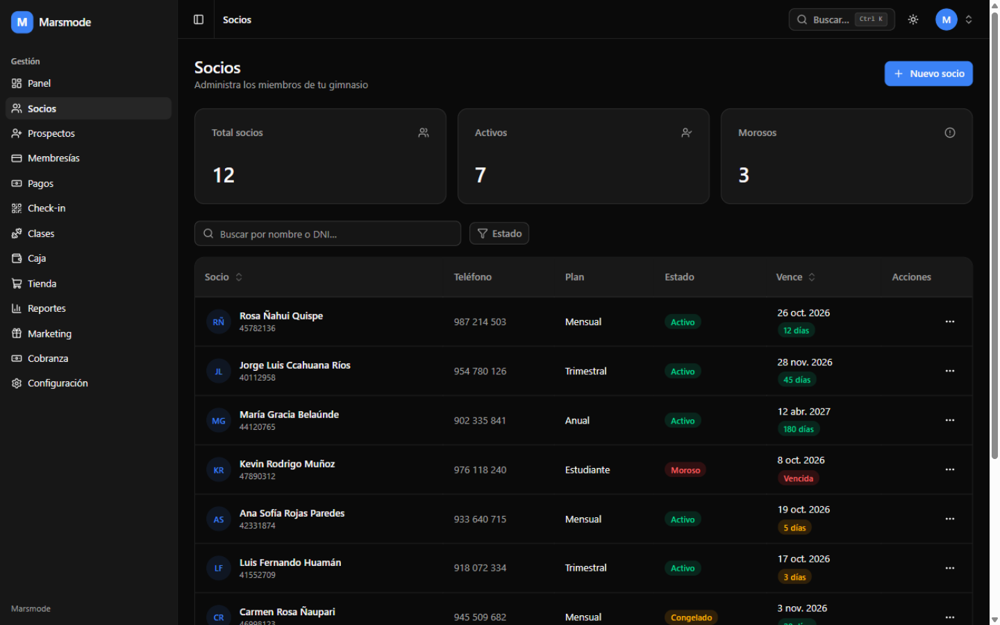
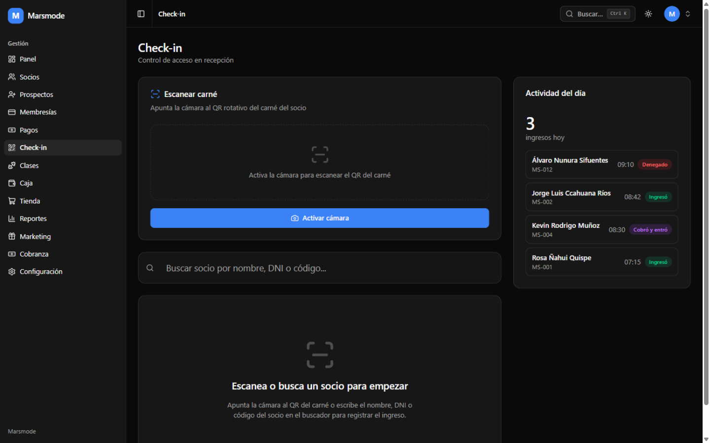
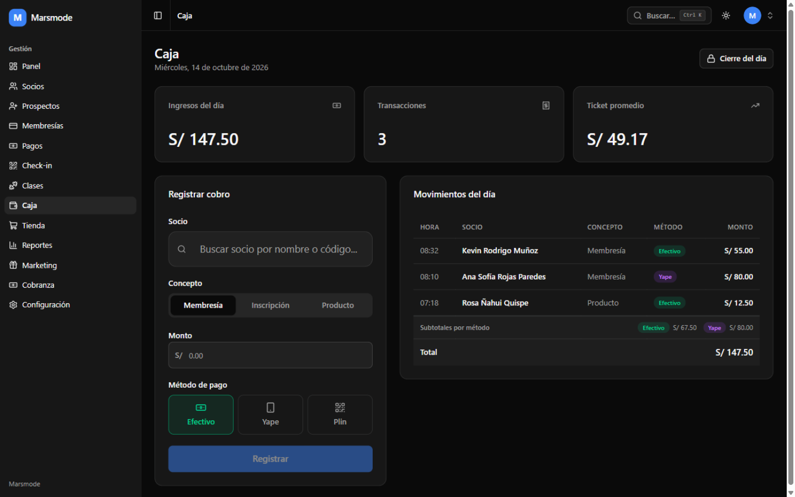
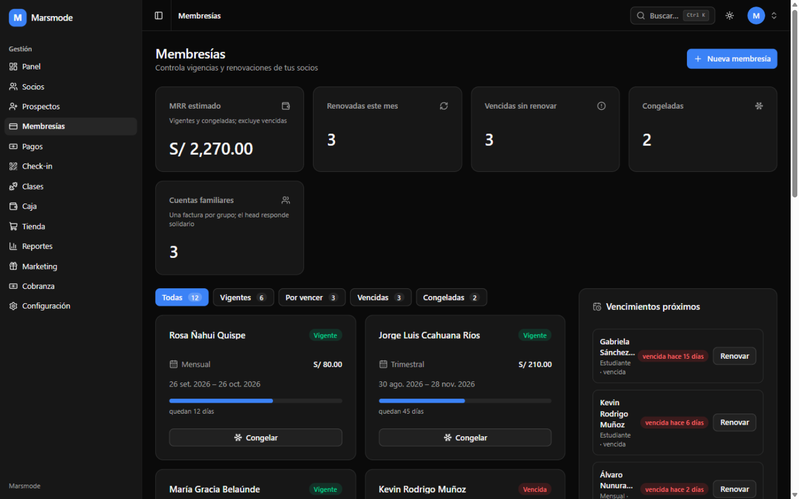
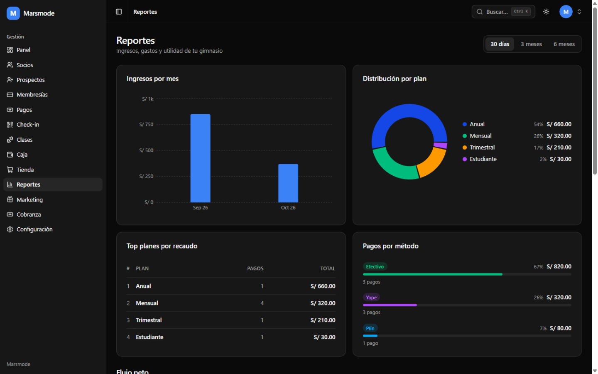

# Marsmode — SaaS de gestión para gimnasios

SaaS multi-tenant de gestión para gimnasios peruanos, enfocado en el dolor #1 del rubro:
membresías vencidas que nadie cobra. Desplegado en producción en [gym.marsmode.me](https://gym.marsmode.me).

## Pantallas

<p>
  
  
</p>
<p>
  
  
</p>
<p>
  
  
</p>

*Capturas del modo demo local (`VITE_DEMO_MODE=1`, datos ficticios).*

## Características

- **Socios y membresías** con estados visibles de un vistazo.
- **Check-in con QR TOTP rotativo** (otplib + escaneo con jsqr): el QR del socio rota,
  no se puede reusar una captura vieja.
- **Caja** con Yape / Plin / efectivo y **cobranza de morosos** (widget de morosidad en el
  dashboard + enlaces directos a WhatsApp).
- **Clases**, **POS** de venta rápida y **CRM de prospectos** con canal de origen
  (walk-in, instagram, facebook, referido, marketplace).
- **Marketing de referidos** y **reportes** con gráficos.
- **PWA instalable** (vite-plugin-pwa): funciona como app en el teléfono del dueño.
- **Multi-tenant real**: cada gimnasio aísla sus datos con RLS por `gym_id` en Supabase
  (21 tablas en la migración inicial).

## Stack

React 19 · Vite · TypeScript · Tailwind 4 · shadcn/radix · react-router 7 · recharts ·
otplib + jsqr + qrcode.react (QR) · Supabase (Postgres + RLS + Auth) · PWA ·
Vitest (62 archivos de test) · Docker multi-stage (node:22-alpine → nginx:alpine) ·
Cloudflare Tunnel.

## Estructura

```
app/              React 19 + Vite (PWA): pages/ por módulo, components/, lib/ con tests
supabase/         migraciones (RLS por gym_id), seed demo y seed-limpio para onboarding
deploy/           nginx.conf, docker-compose.yml, cloudflared
scripts/          gym.ps1: deploy a producción con rollback
docs/             CHECKLIST-DEPLOY.md
```

## Desarrollo

```bash
cd app
npm install
npm run dev       # Vite
npm test          # vitest run (62 archivos)
npm run build     # tsc -b && vite build
```

Requiere `VITE_SUPABASE_URL` y `VITE_SUPABASE_ANON_KEY` en `app/.env*` (ver
`docs/CHECKLIST-DEPLOY.md`).

## Deploy

Docker multi-stage + nginx endurecido + Cloudflare Tunnel, con script de despliegue y
rollback (`scripts/gym.ps1`). Checklist completo en `docs/CHECKLIST-DEPLOY.md`.

## Estado

En producción con clientes reales. El log de desarrollo (sprints, decisiones con su
porqué y lecciones de deploy) se mantiene privado por contener notas de negocio.
